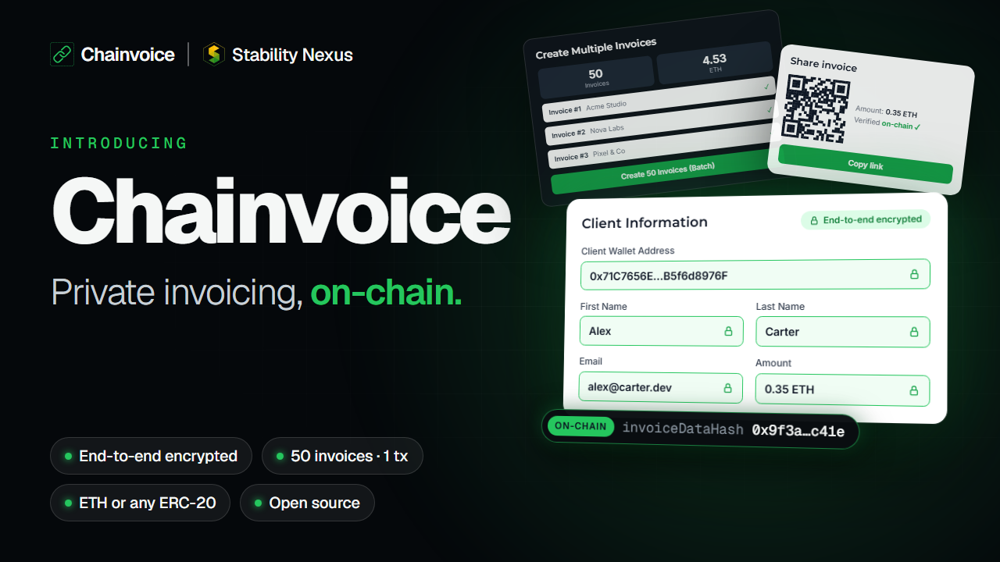

  

<h1 align="center">Google Summer of Code 2026: Final Report</h1>

  <b>Chainvoice: Private On-Chain Invoicing with ThruBox Encrypted Relay</b>

  
  
  
  

---

## Project details

| | |
|---|---|
| **Contributor** | Atharva Girish Naik · [@Atharva0506](https://github.com/Atharva0506) |
| **Organization** | [AOSSIE](https://aossie.org) · [Stability Nexus](https://stability.nexus) |
| **Mentors** | Bruno Woltzenlogel Paleo ([@Zahnentferner](https://github.com/Zahnentferner)) · Yogesh Agrawal ([@yogesh0509](https://github.com/yogesh0509)) · Karan Kumar Kumawat ([@kumawatkaran523](https://github.com/kumawatkaran523)) · Aditya Bhattad ([@adityabhattad2021](https://github.com/adityabhattad2021)) · Aditya Gupta (@AdityaGupta256) |
| **Repositories** | [StabilityNexus/Chainvoice](https://github.com/StabilityNexus/Chainvoice) · [AOSSIE-Org/ThruBox-Server](https://github.com/AOSSIE-Org/ThruBox-Server) · [AOSSIE-Org/ThruBox-Client](https://github.com/AOSSIE-Org/ThruBox-Client) · [AOSSIE-Org/IndexedDB-Import-Export](https://github.com/AOSSIE-Org/IndexedDB-Import-Export) |
| **Project size** | Large (350 hours, 22 weeks) · May 26 – Nov 2, 2026 |
| **Project page** | [chainvoice.stability.nexus](https://chainvoice.stability.nexus) |
| **Demo video** | [Watch the demo](https://drive.google.com/file/d/122KQXxjb4ltC-8FrBgoR3bErSzOM7dU9/view?usp=sharing) |

## Contents

1. [Abstract](#abstract)
2. [Deliverables](#deliverables)
3. [How it works](#how-it-works)
4. [Timeline: Lit → Waku → ThruBox](#timeline-lit--waku--thrubox)
5. [Work done](#work-done)
6. [Deployments](#deployments)
7. [Challenges and lessons](#challenges-and-lessons)
8. [Future work](#future-work)
9. [Acknowledgements](#acknowledgements)
10. [All pull requests](#all-pull-requests)

## Abstract

Chainvoice's privacy layer was broken: Lit Protocol was defunct, so invoice creation and rendering failed for real users. This project rebuilt Chainvoice's privacy architecture end to end and shipped **Chainvoice v2.0.0**.

Invoice details are now encrypted in the browser with **ECIES (secp256k1 + AES-256-GCM)**. Only a 32-byte hash goes on-chain, and recipients check every invoice against that hash. When Waku's rate limiting blocked invoice delivery, I built **ThruBox**, a self-hostable encrypted mailbox relay with a Go server and a TypeScript SDK. I also built **idb-backup**, a reusable IndexedDB backup library that Chainvoice uses for local storage.

All four projects are released. Chainvoice v2 is live on Base and Polygon mainnet, the two libraries are published on npm, and the relay's Docker image is on GHCR.

## Deliverables

| Project | What it is | Release | Published on |
|---|---|---|---|
| [**Chainvoice**](https://github.com/StabilityNexus/Chainvoice) | Private on-chain invoicing dApp (React + Solidity) | [v2.0.0](https://github.com/StabilityNexus/Chainvoice/releases/tag/v2.0.0) | Web: [chainvoice.stability.nexus](https://chainvoice.stability.nexus) |
| [**ThruBox-Server**](https://github.com/AOSSIE-Org/ThruBox-Server)* | Encrypted mailbox relay (Go + SQLite) | [v1.0.0](https://github.com/AOSSIE-Org/ThruBox-Server/releases/tag/v1.0.0) | GHCR: [`ghcr.io/aossie-org/thrubox-server`](https://github.com/AOSSIE-Org/ThruBox-Server/pkgs/container/thrubox-server) |
| [**ThruBox-Client**](https://github.com/AOSSIE-Org/ThruBox-Client)* | TypeScript SDK for ThruBox | [v1.1.0](https://github.com/AOSSIE-Org/ThruBox-Client/releases/tag/v1.1.0) | npm: [`@aossie-org/thrubox-client`](https://www.npmjs.com/package/@aossie-org/thrubox-client) |
| [**IndexedDB-Import-Export**](https://github.com/AOSSIE-Org/IndexedDB-Import-Export)* | IndexedDB backup and restore library | [v1.1.0](https://github.com/AOSSIE-Org/IndexedDB-Import-Export/releases/tag/v1.1.0) | npm: [`@aossie-org/idb-backup`](https://www.npmjs.com/package/@aossie-org/idb-backup) |

* Repository created during GSoC 2026.

### By the numbers

| | Chainvoice | ThruBox-Server | ThruBox-Client | IndexedDB-Import-Export | **Total** |
|---|:-:|:-:|:-:|:-:|:-:|
| **Merged PRs** | 64 | 24 | 24 | 23 | **135** |
| **PRs reviewed** | 32 | 18 | 8 | 9 | **67** |

- I also reviewed **19** PRs in WalletLink, StablePay and Fate.
- npm downloads since May 2026: **1,017** for `@aossie-org/idb-backup` and **416** for `@aossie-org/thrubox-client`.

### Technologies

**Frontend:** React, Vite, Wagmi, Viem, WalletLink, IndexedDB 
**Smart contracts:** Solidity, Foundry, Slither 
**Relay:** Go, SQLite, Docker 
**SDK and libraries:** TypeScript, Vitest 
**Cryptography:** ECIES (secp256k1 + AES-256-GCM) 
**CI/CD:** GitHub Actions, Cloudflare Pages, npm Trusted Publishing (OIDC), GHCR

## How it works

<picture>
  <source media="(prefers-color-scheme: dark)" srcset="https://github.com/user-attachments/assets/1037bf05-5e00-40ca-b8a2-140415652741">
  
</picture>

1. The sender's browser encrypts the invoice details for the recipient's public key (ECIES).
2. The contract stores only the parties, amount, token and a `bytes32` hash of the details.
3. The encrypted payload goes to the recipient's ThruBox mailbox.
4. The recipient decrypts it, checks it against the on-chain hash and pays in the native coin or any ERC-20 token.

<b>Sending an invoice</b>

 
<picture>
  <source media="(prefers-color-scheme: dark)" srcset="https://github.com/user-attachments/assets/447f8f28-2dd5-45de-8f2b-3ea3a822af00">
  
</picture>

<b>Receiving and paying an invoice</b>

 
<picture>
  <source media="(prefers-color-scheme: dark)" srcset="https://github.com/user-attachments/assets/369b3d1a-709f-440e-a8e0-ca0cf2f43f5e">
  
</picture>

## Timeline: Lit → Waku → ThruBox

| Weeks | What happened |
|:-:|---|
| **1–2** | Built `IndexedDB-Import-Export` as a standalone library instead of code embedded in Chainvoice, so other AOSSIE projects can reuse it. Published it as `@aossie-org/idb-backup`. Built PR preview environments to speed up mentor reviews. |
| **3–5** | Removed Lit Protocol. Added ECIES encryption and an on-chain key registry, and cut on-chain invoice storage to a 32-byte hash. Invoice delivery went over Waku. |
| **6** | Waku started rate-limiting LightPush requests, which blocked the frontend. I opened a support ticket with the Waku team. |
| **7** | Since the rate limiting couldn't be fixed in time, we pivoted to a custom relay and designed **ThruBox**: one Go binary with embedded SQLite, no broker and no P2P network. |
| **8–12** | Built the ThruBox server and SDK, published them to npm and GHCR, and wired ThruBox into Chainvoice. Before the midterm, added repository docs across all four repos. |
| **13–17** | Product work: share and import invoices by link or QR code, sender-details onboarding, a new dashboard layout, one-command Docker setup, and a Terms of Use modal. |
| **18–22** | Security review and launch: contract hardening, a QA audit, fixes for all five launch blockers, WalletLink, mainnet deployment on Base and Polygon, and the v1.0.0 / v1.1.0 / v2.0.0 releases. |

## Work done

### 1. Chainvoice v2.0.0

#### Privacy

| PR | Change |
|---|---|
| [#171](https://github.com/StabilityNexus/Chainvoice/pull/171) | Removed Lit Protocol and all its code |
| [#169](https://github.com/StabilityNexus/Chainvoice/pull/169) | On-chain public-key registry and `invoiceDataHash` validation |
| [#195](https://github.com/StabilityNexus/Chainvoice/pull/195) | Invoice payloads go over the ThruBox relay instead of being stored on-chain |
| [#197](https://github.com/StabilityNexus/Chainvoice/pull/197) | Key registration is a step in the invoice flow |
| [#238](https://github.com/StabilityNexus/Chainvoice/pull/238) | Key derivation bound to the site's origin and wallet address, so lookalike sites can't derive keys |
| [#247](https://github.com/StabilityNexus/Chainvoice/pull/247), [#317](https://github.com/StabilityNexus/Chainvoice/pull/317) | Invoices are shown and paid from verified on-chain values, never from the payload |

#### Features

| PR | Change |
|---|---|
| [#209](https://github.com/StabilityNexus/Chainvoice/pull/209) | Share an invoice by link, QR code or `.cvinv` file, and import it before connecting a wallet |
| [#175](https://github.com/StabilityNexus/Chainvoice/pull/175), [#284](https://github.com/StabilityNexus/Chainvoice/pull/284), [#297](https://github.com/StabilityNexus/Chainvoice/pull/297) | Batch invoicing: up to 50 invoices per transaction (15 on Sepolia, to fit its gas limit) |
| [#138](https://github.com/StabilityNexus/Chainvoice/pull/138), [#249](https://github.com/StabilityNexus/Chainvoice/pull/249) | Export to JSON, CSV and PDF |
| [#157](https://github.com/StabilityNexus/Chainvoice/pull/157) | Product catalog import and invoice autofill |
| [#183](https://github.com/StabilityNexus/Chainvoice/pull/183), [#204](https://github.com/StabilityNexus/Chainvoice/pull/204), [#205](https://github.com/StabilityNexus/Chainvoice/pull/205) | Settings page, first-run onboarding and a compact dashboard |
| [#185](https://github.com/StabilityNexus/Chainvoice/pull/185) | Local invoice storage in IndexedDB |
| [#272](https://github.com/StabilityNexus/Chainvoice/pull/272) | Replaced RainbowKit/WalletConnect with WalletLink, Stability Nexus's own wallet connector |
| [#178](https://github.com/StabilityNexus/Chainvoice/pull/178), [#179](https://github.com/StabilityNexus/Chainvoice/pull/179) | Input validation, with tests |

#### Smart contract and security

| PR | Change |
|---|---|
| [#228](https://github.com/StabilityNexus/Chainvoice/pull/228) | SafeERC20 and a check of the amount the issuer actually receives, so USDT-style and fee-on-transfer tokens are safe |
| [#295](https://github.com/StabilityNexus/Chainvoice/pull/295) | Fee roles renamed to `dev`, `devFee` and `devFeeReceiver` |
| [#242](https://github.com/StabilityNexus/Chainvoice/pull/242), [#245](https://github.com/StabilityNexus/Chainvoice/pull/245) | Slither static analysis in CI and reentrancy-guard tests |
| [#307](https://github.com/StabilityNexus/Chainvoice/pull/307), [#319](https://github.com/StabilityNexus/Chainvoice/pull/319) | The relay rejects malformed payloads and never silently replaces a key. The client waits out the relay's rate limit instead of dropping invoices |
| [#320](https://github.com/StabilityNexus/Chainvoice/pull/320), [#225](https://github.com/StabilityNexus/Chainvoice/pull/225) | Pay and cancel can no longer overlap. Batch amounts are summed as BigInt |
| [#332](https://github.com/StabilityNexus/Chainvoice/pull/332), [#335](https://github.com/StabilityNexus/Chainvoice/pull/335) | Fixes from the peer audit before the mainnet deployment |

#### Infrastructure

| PR | Change |
|---|---|
| [#166](https://github.com/StabilityNexus/Chainvoice/pull/166), [#211](https://github.com/StabilityNexus/Chainvoice/pull/211), [#309](https://github.com/StabilityNexus/Chainvoice/pull/309) | PR preview environments, moved off the production origin to Cloudflare Pages |
| [#180](https://github.com/StabilityNexus/Chainvoice/pull/180), [#229](https://github.com/StabilityNexus/Chainvoice/pull/229), [#288](https://github.com/StabilityNexus/Chainvoice/pull/288) | Frontend and contract CI, lint enforcement, a build-size report and drafted release notes |
| [#218](https://github.com/StabilityNexus/Chainvoice/pull/218) | One-command Docker setup for the frontend and a ThruBox relay |
| [#250](https://github.com/StabilityNexus/Chainvoice/pull/250)–[#255](https://github.com/StabilityNexus/Chainvoice/pull/255) | SEO, social cards and lazy loading, which cut the JS bundle by 38% |
| [#315](https://github.com/StabilityNexus/Chainvoice/pull/315) | A working Ethereum Classic network config and Mordor/Amoy testnets |
| [#342](https://github.com/StabilityNexus/Chainvoice/pull/342) | Mainnet deployment on Base and Polygon, and v2 testnet deployments, all verified on Sourcify |

### 2. ThruBox-Server v1.0.0

A small, self-hostable relay that works as a dumb encrypted mailbox. It stores and forwards opaque blobs and never sees plaintext.

| PR | Change |
|---|---|
| [#5](https://github.com/AOSSIE-Org/ThruBox-Server/pull/5)–[#8](https://github.com/AOSSIE-Org/ThruBox-Server/pull/8) | Config system, SQLite store, HTTP handlers and a server with graceful shutdown |
| [#9](https://github.com/AOSSIE-Org/ThruBox-Server/pull/9), [#18](https://github.com/AOSSIE-Org/ThruBox-Server/pull/18) | Docker support, and multi-arch images on GHCR with provenance and an SBOM |
| [#34](https://github.com/AOSSIE-Org/ThruBox-Server/pull/34)–[#36](https://github.com/AOSSIE-Org/ThruBox-Server/pull/36) | `PORT` variable, configurable config path and CORS for browser clients |
| [#67](https://github.com/AOSSIE-Org/ThruBox-Server/pull/67) | Per-mailbox cursors, content-derived message IDs, and a fix for a rate-limit bypass via spoofed `X-Forwarded-For` |
| [#70](https://github.com/AOSSIE-Org/ThruBox-Server/pull/70) | Removed an unauthenticated delete endpoint |

### 3. ThruBox-Client v1.1.0

| PR | Change |
|---|---|
| [#5](https://github.com/AOSSIE-Org/ThruBox-Client/pull/5), [#8](https://github.com/AOSSIE-Org/ThruBox-Client/pull/8) | TypeScript SDK (`send`, `receive`, `poll`) with unit tests |
| [#28](https://github.com/AOSSIE-Org/ThruBox-Client/pull/28) | npm publishing via OIDC Trusted Publishing, with provenance |
| [#63](https://github.com/AOSSIE-Org/ThruBox-Client/pull/63) | Cursor-based polling. The cursor only moves forward after the callback succeeds, so a failed save is retried instead of lost |
| [#65](https://github.com/AOSSIE-Org/ThruBox-Client/pull/65), [#66](https://github.com/AOSSIE-Org/ThruBox-Client/pull/66) | Removed `delete()` and released 1.1.0 |

### 4. IndexedDB-Import-Export v1.1.0

| PR | Change |
|---|---|
| [#11](https://github.com/AOSSIE-Org/IndexedDB-Import-Export/pull/11), [#12](https://github.com/AOSSIE-Org/IndexedDB-Import-Export/pull/12) | Exporter with `Uint8Array` serialization, and an importer with overwrite and merge strategies |
| [#29](https://github.com/AOSSIE-Org/IndexedDB-Import-Export/pull/29) | Exporter, importer and round-trip tests |
| [#31](https://github.com/AOSSIE-Org/IndexedDB-Import-Export/pull/31), [#63](https://github.com/AOSSIE-Org/IndexedDB-Import-Export/pull/63), [#98](https://github.com/AOSSIE-Org/IndexedDB-Import-Export/pull/98) | Automated npm release pipeline |
| [#73](https://github.com/AOSSIE-Org/IndexedDB-Import-Export/pull/73) | Selective restore with `storeNames` |

### 5. Across the organization

- Published audit reports in every repo's `audit/` folder: the peer audit and the AI security review, each with a remediation report ([Chainvoice #343](https://github.com/StabilityNexus/Chainvoice/pull/343), [ThruBox-Server #75](https://github.com/AOSSIE-Org/ThruBox-Server/pull/75), [ThruBox-Client #72](https://github.com/AOSSIE-Org/ThruBox-Client/pull/72), [IndexedDB #116](https://github.com/AOSSIE-Org/IndexedDB-Import-Export/pull/116)).
- Rolled out security-review and remediation tooling to all four repos ([Chainvoice #221](https://github.com/StabilityNexus/Chainvoice/pull/221), [ThruBox-Server #49](https://github.com/AOSSIE-Org/ThruBox-Server/pull/49), [ThruBox-Client #44](https://github.com/AOSSIE-Org/ThruBox-Client/pull/44), [IndexedDB #94](https://github.com/AOSSIE-Org/IndexedDB-Import-Export/pull/94)).
- Set up npm publishing CI for [WalletLink](https://github.com/StabilityNexus/WalletLink/pull/8) and [SocialShareButton](https://github.com/AOSSIE-Org/SocialShareButton/pull/156).
- Added repository guidelines, `AGENTS.md` and maintainer docs to all four repos.

## Deployments

All v2 contracts are built from the same commit and verified on [Sourcify](https://sourcify.dev) with an exact match ([#342](https://github.com/StabilityNexus/Chainvoice/pull/342)).

| Network | Chain ID | Type | `Chainvoice.sol` |
|---|:-:|:-:|---|
| Base | 8453 | Mainnet | [`0x9b31091AA0b4F287114B2A9a3D239Db04a9A07E1`](https://basescan.org/address/0x9b31091AA0b4F287114B2A9a3D239Db04a9A07E1) |
| Polygon | 137 | Mainnet | [`0x9b31091AA0b4F287114B2A9a3D239Db04a9A07E1`](https://polygonscan.com/address/0x9b31091AA0b4F287114B2A9a3D239Db04a9A07E1) |
| Ethereum Sepolia | 11155111 | Testnet | [`0x6E5Ac5C2c10b4eD34909CFf0DF776832504E9677`](https://sepolia.etherscan.io/address/0x6E5Ac5C2c10b4eD34909CFf0DF776832504E9677) |
| Ethereum Classic Mordor | 63 | Testnet | [`0x9b306924Eef2f021E1BC8a54202E90057E3988d8`](https://etc-mordor.blockscout.com/address/0x9b306924Eef2f021E1BC8a54202E90057E3988d8) |
| Polygon Amoy | 80002 | Testnet | [`0xBee456a4eF315273E9b6bC1C9eE0737aefD461e0`](https://amoy.polygonscan.com/address/0xBee456a4eF315273E9b6bC1C9eE0737aefD461e0) |

## Challenges and lessons

- **Don't let an external dependency block you.** Waku's rate limiting stopped frontend work for weeks. Building ThruBox was more work up front, but it gave the project a relay we control, can test and can self-host.
- **Make things reusable.** Building `idb-backup` and ThruBox as standalone libraries instead of code embedded in Chainvoice means other projects can use them. Both are published with automated, provenance-signed releases.
- **Review speed matters.** PRs waiting on review for weeks were the biggest slowdown. PR preview environments and smaller PRs helped mentors review faster.
- **Audit before launch.** A full QA and security audit before the release found five launch blockers, including a payload that could crash a recipient's page and key derivation that wasn't bound to the origin. All five were fixed before release.

## Future work

- Grow ThruBox into a general-purpose relay for other AOSSIE and Stability Nexus apps, for example as the transport for WalletLink mobile.
- Push notifications for new invoices, and running ThruBox on several relays for redundancy.
- Add more EVM chains as Chainvoice is deployed to them.

## Acknowledgements

Thank you to my mentors [@Zahnentferner](https://github.com/Zahnentferner), [@yogesh0509](https://github.com/yogesh0509), [@kumawatkaran523](https://github.com/kumawatkaran523), [@adityabhattad2021](https://github.com/adityabhattad2021) and Aditya Gupta (@AdityaGupta256) for their reviews, guidance and patience, especially during the Waku → ThruBox pivot and the mainnet deployment. Thanks also to the AOSSIE and Stability Nexus community, and to every contributor whose PRs went into Chainvoice v2.0.0.

## All pull requests

152 PRs across 9 repositories (141 merged, 5 open, 6 closed) as of Oct 29, 2026.

<b>StabilityNexus/Chainvoice</b>: 72 PRs, 64 merged, 2 open, 6 closed

| PR | Title | Status | Opened |
|---|---|---|---|
| [#164](https://github.com/StabilityNexus/Chainvoice/pull/164) | Test/pr preview 3 | Closed | 2026-06-10 |
| [#165](https://github.com/StabilityNexus/Chainvoice/pull/165) | perf: reduce frontend build size | Merged | 2026-06-10 |
| [#166](https://github.com/StabilityNexus/Chainvoice/pull/166) | ci: add PR previews, update guidelines, fix router basename | Merged | 2026-06-10 |
| [#167](https://github.com/StabilityNexus/Chainvoice/pull/167) | feat: replace Lit Protocol with Waku for invoice privacy | Closed | 2026-06-14 |
| [#169](https://github.com/StabilityNexus/Chainvoice/pull/169) | feat(contract): add Waku public key registry and invoiceDataHash vali… | Merged | 2026-06-22 |
| [#171](https://github.com/StabilityNexus/Chainvoice/pull/171) | chore: remove Lit Protocol and all associated logic | Merged | 2026-06-24 |
| [#175](https://github.com/StabilityNexus/Chainvoice/pull/175) | Fix: Update ChainvoiceABI.js to include batch invoice functions | Merged | 2026-06-26 |
| [#176](https://github.com/StabilityNexus/Chainvoice/pull/176) | fix(rpc): override mainnet RPC to resolve CORS errors on eth.merkle.io | Merged | 2026-06-27 |
| [#178](https://github.com/StabilityNexus/Chainvoice/pull/178) | fix: comprehensive invoice validation and UI enhancements | Merged | 2026-07-01 |
| [#179](https://github.com/StabilityNexus/Chainvoice/pull/179) | Tests for invoice validation | Merged | 2026-07-02 |
| [#180](https://github.com/StabilityNexus/Chainvoice/pull/180) | ci: add frontend test and build workflow with label reporting | Merged | 2026-07-02 |
| [#183](https://github.com/StabilityNexus/Chainvoice/pull/183) | feat: move product catalog to new settings page | Merged | 2026-07-04 |
| [#185](https://github.com/StabilityNexus/Chainvoice/pull/185) | Feat/indexeddb storage | Merged | 2026-07-10 |
| [#186](https://github.com/StabilityNexus/Chainvoice/pull/186) | Unblock `test-and-build` by making lint non-gating | Merged | 2026-07-10 |
| [#190](https://github.com/StabilityNexus/Chainvoice/pull/190) | fix: resolve all lint errors | Merged | 2026-07-24 |
| [#191](https://github.com/StabilityNexus/Chainvoice/pull/191) | fix(ci): handle Resource not accessible by integration error in PR co… | Closed | 2026-07-25 |
| [#193](https://github.com/StabilityNexus/Chainvoice/pull/193) | chore: sync ChainvoiceABI with deployed hash-based contract | Merged | 2026-08-08 |
| [#194](https://github.com/StabilityNexus/Chainvoice/pull/194) | feat: add ThruBox relay service layer for encrypted invoice delivery | Closed | 2026-08-08 |
| [#195](https://github.com/StabilityNexus/Chainvoice/pull/195) | feat: deliver invoice payloads over the relay instead of on-chain | Merged | 2026-08-08 |
| [#196](https://github.com/StabilityNexus/Chainvoice/pull/196) | refactor: drop Waku from the key registry naming | Merged | 2026-08-08 |
| [#197](https://github.com/StabilityNexus/Chainvoice/pull/197) | feat: make key registration a step in the invoice flow | Merged | 2026-08-08 |
| [#198](https://github.com/StabilityNexus/Chainvoice/pull/198) | docs: add repository guidelines and documentation | Merged | 2026-08-10 |
| [#199](https://github.com/StabilityNexus/Chainvoice/pull/199) | Fix `test-and-build` workflow failure from insufficient GitHub token permissions | Merged | 2026-08-18 |
| [#200](https://github.com/StabilityNexus/Chainvoice/pull/200) | fix: report PR test/build results from a workflow_run job | Merged | 2026-08-18 |
| [#204](https://github.com/StabilityNexus/Chainvoice/pull/204) | feat: move sender details to Settings with first-run onboarding | Merged | 2026-08-26 |
| [#205](https://github.com/StabilityNexus/Chainvoice/pull/205) | feat: compact dashboard layout with a collapsible sidebar and hamburger | Merged | 2026-08-26 |
| [#208](https://github.com/StabilityNexus/Chainvoice/pull/208) | chore: remove deprecated contributor onboarding workflow | Merged | 2026-09-01 |
| [#209](https://github.com/StabilityNexus/Chainvoice/pull/209) | feat: share an invoice by link or QR code, and import it | Merged | 2026-09-03 |
| [#211](https://github.com/StabilityNexus/Chainvoice/pull/211) | ci: build PR previews in the pull request's own context | Merged | 2026-09-04 |
| [#212](https://github.com/StabilityNexus/Chainvoice/pull/212) | ci: stop hiding the preview base marker from its own artifact | Merged | 2026-09-04 |
| [#218](https://github.com/StabilityNexus/Chainvoice/pull/218) | feat(docker): run the frontend and a ThruBox relay with one command | Merged | 2026-09-20 |
| [#221](https://github.com/StabilityNexus/Chainvoice/pull/221) | Add security-review and security-remediation skills | Merged | 2026-09-23 |
| [#222](https://github.com/StabilityNexus/Chainvoice/pull/222) | feat: add the daily Terms of Use modal and footer link | Merged | 2026-09-24 |
| [#225](https://github.com/StabilityNexus/Chainvoice/pull/225) | fix: sum batch payment amounts as BigInt in the balance check | Merged | 2026-09-26 |
| [#228](https://github.com/StabilityNexus/Chainvoice/pull/228) | feat(contract): harden token payments and prepare the redeploy build | Merged | 2026-10-02 |
| [#229](https://github.com/StabilityNexus/Chainvoice/pull/229) | ci(contracts): build and test contracts on every contract change | Merged | 2026-10-02 |
| [#231](https://github.com/StabilityNexus/Chainvoice/pull/231) | fix(invoices): restore the frontend build broken by the #216 merge | Merged | 2026-10-03 |
| [#232](https://github.com/StabilityNexus/Chainvoice/pull/232) | Remove unused `_isERC20` helper and keep strict token validation path | Closed | 2026-10-03 |
| [#238](https://github.com/StabilityNexus/Chainvoice/pull/238) | fix(relay): bind key-derivation message to origin and address | Merged | 2026-10-06 |
| [#239](https://github.com/StabilityNexus/Chainvoice/pull/239) | fix(ui): replace DOM-mutating image fallbacks with ImageWithFallback | Merged | 2026-10-06 |
| [#240](https://github.com/StabilityNexus/Chainvoice/pull/240) | fix(invoices): store and show issue/due dates as calendar days | Closed | 2026-10-06 |
| [#241](https://github.com/StabilityNexus/Chainvoice/pull/241) | refactor(filters): use theme tokens in the invoice filter bar | Merged | 2026-10-06 |
| [#242](https://github.com/StabilityNexus/Chainvoice/pull/242) | ci(contracts): run Slither static analysis | Merged | 2026-10-06 |
| [#245](https://github.com/StabilityNexus/Chainvoice/pull/245) | test(contracts): cover reentrancy guards and triage the Slither finding | Merged | 2026-10-07 |
| [#246](https://github.com/StabilityNexus/Chainvoice/pull/246) | fix(abi): regenerate the Chainvoice ABI from the merged contract | Merged | 2026-10-07 |
| [#247](https://github.com/StabilityNexus/Chainvoice/pull/247) | fix(invoices): show and pay invoices from on-chain values | Merged | 2026-10-07 |
| [#248](https://github.com/StabilityNexus/Chainvoice/pull/248) | fix(received): use one selection checkbox for payment and export | Merged | 2026-10-07 |
| [#249](https://github.com/StabilityNexus/Chainvoice/pull/249) | fix(export): make PDF export work and fix separate-file exports | Merged | 2026-10-07 |
| [#250](https://github.com/StabilityNexus/Chainvoice/pull/250) | feat(seo): add robots.txt and sitemap.xml | Merged | 2026-10-08 |
| [#251](https://github.com/StabilityNexus/Chainvoice/pull/251) | fix(routing): deep links land on Landing; base-path-unaware asset URLs | Merged | 2026-10-09 |
| [#252](https://github.com/StabilityNexus/Chainvoice/pull/252) | fix(chains): replace dead public RPCs and add ETC/Citrea chain names | Merged | 2026-10-09 |
| [#253](https://github.com/StabilityNexus/Chainvoice/pull/253) | chore: fix typos, remove dead code and unused dependencies | Merged | 2026-10-09 |
| [#254](https://github.com/StabilityNexus/Chainvoice/pull/254) | feat(seo): per-route titles, 1200x630 social card, brand favicons and JSON-LD | Merged | 2026-10-09 |
| [#255](https://github.com/StabilityNexus/Chainvoice/pull/255) | perf: lazy-load export, share and scan libraries; fix font weights | Merged | 2026-10-09 |
| [#272](https://github.com/StabilityNexus/Chainvoice/pull/272) | feat(wallet): replace RainbowKit/WalletConnect with WalletLink | Merged | 2026-10-13 |
| [#284](https://github.com/StabilityNexus/Chainvoice/pull/284) | fix(batch): allow repeat clients, one batch ID, factual stat and error toasts | Merged | 2026-10-14 |
| [#288](https://github.com/StabilityNexus/Chainvoice/pull/288) | ci: fix the build-size report, enforce lint, skip unaffected jobs, draft release notes | Merged | 2026-10-15 |
| [#295](https://github.com/StabilityNexus/Chainvoice/pull/295) | feat(contracts)!: rename fee roles to dev, devFee and devFeeReceiver | Merged | 2026-10-17 |
| [#297](https://github.com/StabilityNexus/Chainvoice/pull/297) | fix(batch): cap Sepolia batches at 15 invoices to fit its gas cap | Merged | 2026-10-18 |
| [#306](https://github.com/StabilityNexus/Chainvoice/pull/306) | docs: describe Chainvoice as chain-neutral across EVM chains | Merged | 2026-10-19 |
| [#307](https://github.com/StabilityNexus/Chainvoice/pull/307) | fix(relay): reject malformed invoice payloads and never replace a registered key silently | Merged | 2026-10-19 |
| [#309](https://github.com/StabilityNexus/Chainvoice/pull/309) | ci(preview): move PR previews off the production origin to Cloudflare Pages | Merged | 2026-10-20 |
| [#315](https://github.com/StabilityNexus/Chainvoice/pull/315) | fix(network): working ETC config, deployed chains only, Mordor + Amoy testnets | Merged | 2026-10-21 |
| [#317](https://github.com/StabilityNexus/Chainvoice/pull/317) | fix(invoices): show the real chain, token and fee in drawers, export and import | Merged | 2026-10-22 |
| [#318](https://github.com/StabilityNexus/Chainvoice/pull/318) | fix(landing): describe what Chainvoice actually does on Landing and About | Merged | 2026-10-22 |
| [#319](https://github.com/StabilityNexus/Chainvoice/pull/319) | fix(relay): wait out the relay's rate limit instead of dropping invoices | Merged | 2026-10-22 |
| [#320](https://github.com/StabilityNexus/Chainvoice/pull/320) | fix(payments): stop overlapping pay and cancel transactions, refetch after failures | Merged | 2026-10-22 |
| [#328](https://github.com/StabilityNexus/Chainvoice/pull/328) | ci: add issue moderator and anti-slop PR workflows | Merged | 2026-10-24 |
| [#332](https://github.com/StabilityNexus/Chainvoice/pull/332) | fix(contracts): emit DevFeesWithdrawn and tidy before mainnet deploy | Merged | 2026-10-25 |
| [#335](https://github.com/StabilityNexus/Chainvoice/pull/335) | fix: peer audit fixes | Merged | 2026-10-25 |
| [#342](https://github.com/StabilityNexus/Chainvoice/pull/342) | docs(deployments): record the v2 contracts on Base, Polygon and the testnets | Open | 2026-10-27 |
| [#343](https://github.com/StabilityNexus/Chainvoice/pull/343) | docs(audit): add the peer audit and security review with remediation reports | Open | 2026-10-29 |

<b>AOSSIE-Org/ThruBox-Server</b>: 24 PRs, 24 merged

| PR | Title | Status | Opened |
|---|---|---|---|
| [#2](https://github.com/AOSSIE-Org/ThruBox-Server/pull/2) | fix: replace LaTeX .gitignore with Go-specific patterns | Merged | 2026-07-11 |
| [#3](https://github.com/AOSSIE-Org/ThruBox-Server/pull/3) | chore: optimize CodeRabbit configuration for Go project | Merged | 2026-07-11 |
| [#4](https://github.com/AOSSIE-Org/ThruBox-Server/pull/4) | Docs/update readme | Merged | 2026-07-11 |
| [#5](https://github.com/AOSSIE-Org/ThruBox-Server/pull/5) | feat: add Go module, config system, and default config file | Merged | 2026-07-12 |
| [#6](https://github.com/AOSSIE-Org/ThruBox-Server/pull/6) | feat: add Message model and Store interface with SQLite backend | Merged | 2026-07-12 |
| [#7](https://github.com/AOSSIE-Org/ThruBox-Server/pull/7) | feat: add HTTP handlers and middleware | Merged | 2026-07-12 |
| [#8](https://github.com/AOSSIE-Org/ThruBox-Server/pull/8) | feat: add server entrypoint with graceful shutdown | Merged | 2026-07-12 |
| [#9](https://github.com/AOSSIE-Org/ThruBox-Server/pull/9) | feat: add Docker and Docker Compose support | Merged | 2026-07-12 |
| [#10](https://github.com/AOSSIE-Org/ThruBox-Server/pull/10) | fix: update Dockerfile to Go 1.23 and add missing dependencies to go.mod | Merged | 2026-07-15 |
| [#17](https://github.com/AOSSIE-Org/ThruBox-Server/pull/17) | chore(ci): remove unused language setup steps | Merged | 2026-07-21 |
| [#18](https://github.com/AOSSIE-Org/ThruBox-Server/pull/18) | ci: configure docker publish to ghcr | Merged | 2026-07-22 |
| [#20](https://github.com/AOSSIE-Org/ThruBox-Server/pull/20) | docs: add ThruBox logo to README | Merged | 2026-07-30 |
| [#21](https://github.com/AOSSIE-Org/ThruBox-Server/pull/21) | ci: remove obsolete CodeRabbit dispatch workflow | Merged | 2026-07-30 |
| [#24](https://github.com/AOSSIE-Org/ThruBox-Server/pull/24) | chore: fix CI issues | Merged | 2026-08-04 |
| [#31](https://github.com/AOSSIE-Org/ThruBox-Server/pull/31) | docs: add repository guidelines and documentation | Merged | 2026-08-10 |
| [#34](https://github.com/AOSSIE-Org/ThruBox-Server/pull/34) | fix: support the standard PORT environment variable | Merged | 2026-08-20 |
| [#35](https://github.com/AOSSIE-Org/ThruBox-Server/pull/35) | fix: load config.yaml from a configurable path | Merged | 2026-08-20 |
| [#36](https://github.com/AOSSIE-Org/ThruBox-Server/pull/36) | feat: add configurable CORS support for direct browser clients | Merged | 2026-08-20 |
| [#49](https://github.com/AOSSIE-Org/ThruBox-Server/pull/49) | Add security-remediation skill and restructure security-review report format | Merged | 2026-09-23 |
| [#56](https://github.com/AOSSIE-Org/ThruBox-Server/pull/56) | Address follow-up CodeRabbit feedback on security skills | Merged | 2026-10-01 |
| [#57](https://github.com/AOSSIE-Org/ThruBox-Server/pull/57) | Fix YAML frontmatter parse error in security-review's description | Merged | 2026-10-01 |
| [#67](https://github.com/AOSSIE-Org/ThruBox-Server/pull/67) | Fix rate-limit bypass, add mailbox cursor, and release 1.0.0 | Merged | 2026-10-26 |
| [#70](https://github.com/AOSSIE-Org/ThruBox-Server/pull/70) | Remove the DELETE /api/messages/{id} endpoint | Merged | 2026-10-26 |
| [#75](https://github.com/AOSSIE-Org/ThruBox-Server/pull/75) | docs(audit): add the security review and remediation reports | Merged | 2026-10-29 |

<b>AOSSIE-Org/ThruBox-Client</b>: 24 PRs, 24 merged

| PR | Title | Status | Opened |
|---|---|---|---|
| [#2](https://github.com/AOSSIE-Org/ThruBox-Client/pull/2) | fix: replace LaTeX .gitignore with Node.js/TypeScript patterns | Merged | 2026-07-12 |
| [#3](https://github.com/AOSSIE-Org/ThruBox-Client/pull/3) | chore: optimize CodeRabbit config for TypeScript SDK | Merged | 2026-07-12 |
| [#4](https://github.com/AOSSIE-Org/ThruBox-Client/pull/4) | docs: replace template README with ThruBox Client SDK documentation | Merged | 2026-07-12 |
| [#5](https://github.com/AOSSIE-Org/ThruBox-Client/pull/5) | feat: add TypeScript SDK source and build configuration | Merged | 2026-07-13 |
| [#6](https://github.com/AOSSIE-Org/ThruBox-Client/pull/6) | chore(ci): add npm publish job to version-release workflow | Merged | 2026-07-13 |
| [#7](https://github.com/AOSSIE-Org/ThruBox-Client/pull/7) | chore: remove Go/binary template artifacts irrelevant to TypeScript SDK | Merged | 2026-07-13 |
| [#8](https://github.com/AOSSIE-Org/ThruBox-Client/pull/8) | feat: add unit tests for RelayClient | Merged | 2026-07-14 |
| [#14](https://github.com/AOSSIE-Org/ThruBox-Client/pull/14) | docs: add ThruBox logo to README | Merged | 2026-07-30 |
| [#15](https://github.com/AOSSIE-Org/ThruBox-Client/pull/15) | ci: remove obsolete CodeRabbit dispatch workflow | Merged | 2026-07-30 |
| [#16](https://github.com/AOSSIE-Org/ThruBox-Client/pull/16) | fix: resolve release drafter permissions and publish workflow issues | Merged | 2026-08-01 |
| [#17](https://github.com/AOSSIE-Org/ThruBox-Client/pull/17) | chore: commit package-lock.json to fix CI | Merged | 2026-08-03 |
| [#18](https://github.com/AOSSIE-Org/ThruBox-Client/pull/18) | chore: remove coderabbit approval workflow | Merged | 2026-08-03 |
| [#19](https://github.com/AOSSIE-Org/ThruBox-Client/pull/19) | fix: change npm scope to @aossie-org | Merged | 2026-08-03 |
| [#20](https://github.com/AOSSIE-Org/ThruBox-Client/pull/20) | chore: release v1.0.1 | Merged | 2026-08-03 |
| [#21](https://github.com/AOSSIE-Org/ThruBox-Client/pull/21) | fix: add npm auth verification step before publish | Merged | 2026-08-03 |
| [#22](https://github.com/AOSSIE-Org/ThruBox-Client/pull/22) | Fix/npm auth check | Merged | 2026-08-03 |
| [#28](https://github.com/AOSSIE-Org/ThruBox-Client/pull/28) | ci: migrate npm publish to Trusted Publishing (OIDC) | Merged | 2026-08-05 |
| [#30](https://github.com/AOSSIE-Org/ThruBox-Client/pull/30) | docs: fix package name in README | Merged | 2026-08-07 |
| [#31](https://github.com/AOSSIE-Org/ThruBox-Client/pull/31) | docs: add repository guidelines and documentation | Merged | 2026-08-10 |
| [#44](https://github.com/AOSSIE-Org/ThruBox-Client/pull/44) | Add security-review and security-remediation skills | Merged | 2026-09-23 |
| [#63](https://github.com/AOSSIE-Org/ThruBox-Client/pull/63) | Support mailbox cursors and fix the release pipeline | Merged | 2026-10-26 |
| [#65](https://github.com/AOSSIE-Org/ThruBox-Client/pull/65) | Remove RelayClient.delete() and release 1.1.0 | Merged | 2026-10-26 |
| [#66](https://github.com/AOSSIE-Org/ThruBox-Client/pull/66) | Fix the npm release build so 1.1.0 can be published | Merged | 2026-10-26 |
| [#72](https://github.com/AOSSIE-Org/ThruBox-Client/pull/72) | docs(audit): add the security review and remediation reports | Merged | 2026-10-29 |

<b>AOSSIE-Org/IndexedDB-Import-Export</b>: 23 PRs, 23 merged

| PR | Title | Status | Opened |
|---|---|---|---|
| [#6](https://github.com/AOSSIE-Org/IndexedDB-Import-Export/pull/6) | chore: initialize project configuration | Merged | 2026-05-29 |
| [#7](https://github.com/AOSSIE-Org/IndexedDB-Import-Export/pull/7) | Chore/scaffold folder structure | Merged | 2026-05-29 |
| [#11](https://github.com/AOSSIE-Org/IndexedDB-Import-Export/pull/11) | feat: implement Uint8Array serialization and core exporter | Merged | 2026-06-04 |
| [#12](https://github.com/AOSSIE-Org/IndexedDB-Import-Export/pull/12) | feat: implement core importer with overwrite and merge strategies | Merged | 2026-06-04 |
| [#13](https://github.com/AOSSIE-Org/IndexedDB-Import-Export/pull/13) | docs: rewrite README for aossie-idb-backup library | Merged | 2026-06-04 |
| [#29](https://github.com/AOSSIE-Org/IndexedDB-Import-Export/pull/29) | test: add comprehensive exporter, importer, and round-trip tests | Merged | 2026-06-15 |
| [#30](https://github.com/AOSSIE-Org/IndexedDB-Import-Export/pull/30) | chore: bump version from 0.1.0 to 1.0.0 | Merged | 2026-06-15 |
| [#31](https://github.com/AOSSIE-Org/IndexedDB-Import-Export/pull/31) | Ci: npm publish workflow | Merged | 2026-06-16 |
| [#32](https://github.com/AOSSIE-Org/IndexedDB-Import-Export/pull/32) | ci: add workflow_dispatch to allow manual triggering of release | Merged | 2026-06-17 |
| [#33](https://github.com/AOSSIE-Org/IndexedDB-Import-Export/pull/33) | ci: fix security check by verifying repository permissions instead of… | Merged | 2026-06-17 |
| [#34](https://github.com/AOSSIE-Org/IndexedDB-Import-Export/pull/34) | ci: fix git push auth and update Node.js to 22 LTS | Merged | 2026-06-18 |
| [#46](https://github.com/AOSSIE-Org/IndexedDB-Import-Export/pull/46) | docs: update README with current package name and API | Merged | 2026-07-06 |
| [#61](https://github.com/AOSSIE-Org/IndexedDB-Import-Export/pull/61) | ci: migrate npm publish to Trusted Publishing (OIDC) | Merged | 2026-08-05 |
| [#62](https://github.com/AOSSIE-Org/IndexedDB-Import-Export/pull/62) | fix: quote mermaid node labels containing special characters | Merged | 2026-08-05 |
| [#63](https://github.com/AOSSIE-Org/IndexedDB-Import-Export/pull/63) | ci: split publish into build and publish jobs | Merged | 2026-08-05 |
| [#65](https://github.com/AOSSIE-Org/IndexedDB-Import-Export/pull/65) | docs: add repository guidelines and documentation | Merged | 2026-08-13 |
| [#73](https://github.com/AOSSIE-Org/IndexedDB-Import-Export/pull/73) | feat: add storeNames to ImportOptions for selective restore | Merged | 2026-08-25 |
| [#74](https://github.com/AOSSIE-Org/IndexedDB-Import-Export/pull/74) | docs: add PRIVACY.md adapted from the org template | Merged | 2026-08-25 |
| [#94](https://github.com/AOSSIE-Org/IndexedDB-Import-Export/pull/94) | Update security-review skill, add security-remediation skill | Merged | 2026-09-23 |
| [#96](https://github.com/AOSSIE-Org/IndexedDB-Import-Export/pull/96) | ci(release-drafter): resolve minor bumps from feature labels, drop PR trigger | Merged | 2026-09-29 |
| [#97](https://github.com/AOSSIE-Org/IndexedDB-Import-Export/pull/97) | chore: bump version to 1.1.0 | Merged | 2026-09-29 |
| [#98](https://github.com/AOSSIE-Org/IndexedDB-Import-Export/pull/98) | ci(release): create pack directory and allow resuming a failed publish | Merged | 2026-09-29 |
| [#116](https://github.com/AOSSIE-Org/IndexedDB-Import-Export/pull/116) | docs(audit): add the security review and remediation reports | Merged | 2026-10-29 |

<b>AOSSIE-Org/SocialShareButton</b>: 3 PRs, 2 merged, 1 open

| PR | Title | Status | Opened |
|---|---|---|---|
| [#156](https://github.com/AOSSIE-Org/SocialShareButton/pull/156) | feat: setup npm publish workflow via github actions | Merged | 2026-06-23 |
| [#176](https://github.com/AOSSIE-Org/SocialShareButton/pull/176) | fix: update pnpm/action-setup to v4 and enable dependabot | Merged | 2026-07-16 |
| [#218](https://github.com/AOSSIE-Org/SocialShareButton/pull/218) | ci: migrate npm publish to Trusted Publishing (OIDC) | Open | 2026-08-05 |

<b>StabilityNexus/Tectonic-EVM-WebUI</b>: 1 PRs, 0 merged, 1 open

| PR | Title | Status | Opened |
|---|---|---|---|
| [#29](https://github.com/StabilityNexus/Tectonic-EVM-WebUI/pull/29) | fix: hero globe, scroll arrow and wordmark shadow from design review | Open | 2026-08-24 |

<b>StabilityNexus/VouchMe</b>: 1 PRs, 1 merged

| PR | Title | Status | Opened |
|---|---|---|---|
| [#42](https://github.com/StabilityNexus/VouchMe/pull/42) | refactor: replace require strings with custom errors for gas optimiza… | Merged | 2026-05-15 |

<b>StabilityNexus/WalletLink</b>: 3 PRs, 3 merged

| PR | Title | Status | Opened |
|---|---|---|---|
| [#8](https://github.com/StabilityNexus/WalletLink/pull/8) | Add npm publish CI workflow, VERSION file, and Dependabot config | Merged | 2026-08-31 |
| [#13](https://github.com/StabilityNexus/WalletLink/pull/13) | Fix CI: create pack destination directory before npm pack | Merged | 2026-09-02 |
| [#15](https://github.com/StabilityNexus/WalletLink/pull/15) | Release 0.1.1 — first end-to-end test of the automated release CI | Merged | 2026-09-21 |

<b>StabilityNexus/Website</b>: 1 PRs, 0 merged, 1 open

| PR | Title | Status | Opened |
|---|---|---|---|
| [#66](https://github.com/StabilityNexus/Website/pull/66) | feat: add ThruBox application to website | Open | 2026-08-01 |

